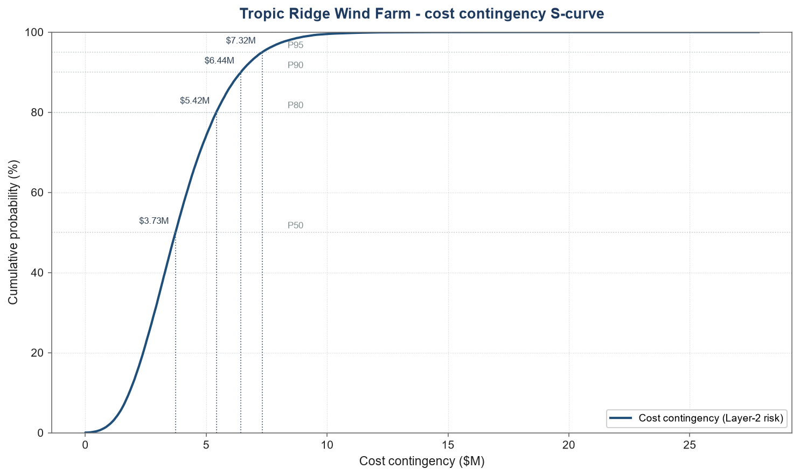
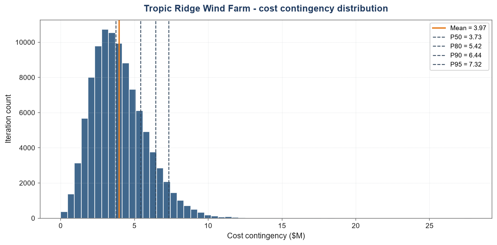
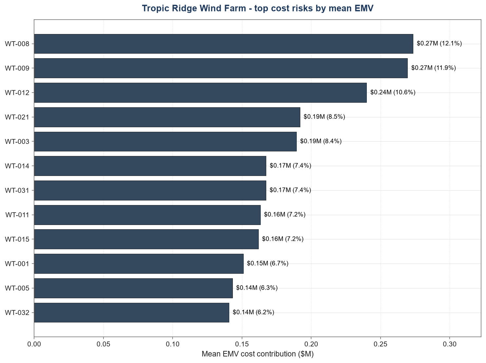
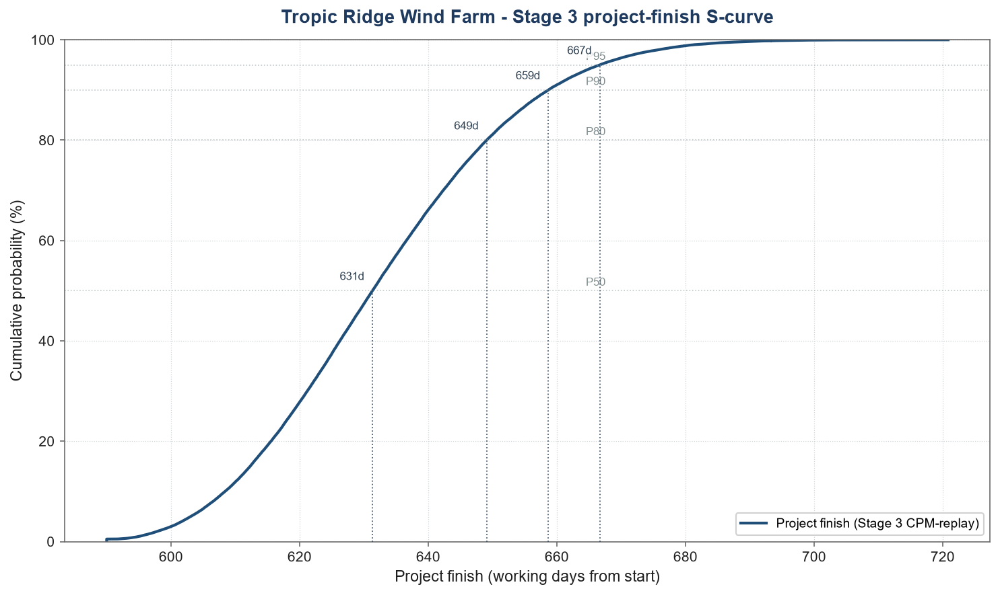
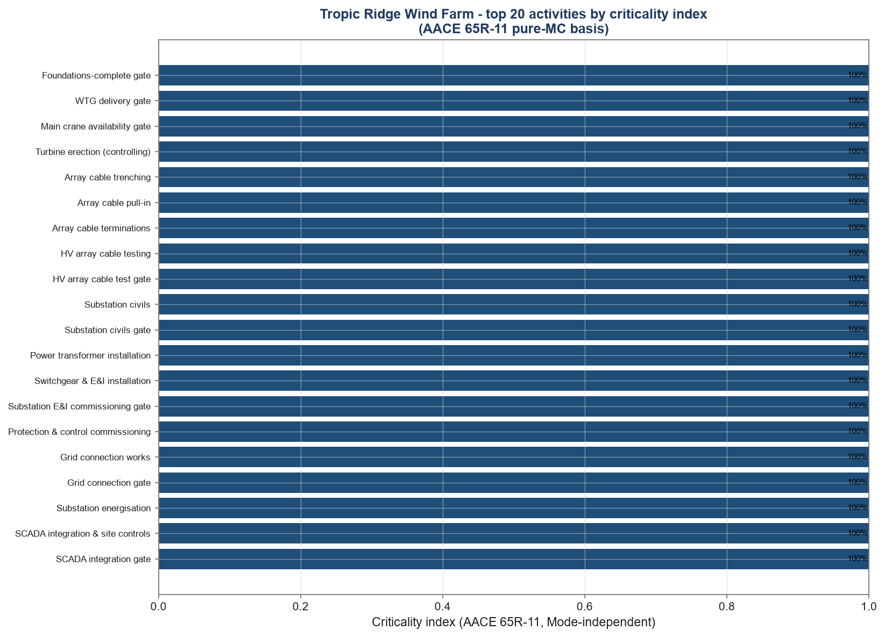

<!--
showcase-P5 WS5-D summary derivative. Content-staging artefact:
P6 lifts this into the public blog (pillars 1 and 2 and the LinkedIn
carousels). Figures are the committed Tropic Ridge Wind Farm showcase run
(seed 42); prose is selected and framed from the existing wind outputs, not
rewritten. ASCII only (no em/en dashes); zero client identifiers; gated by
the wind leak gate (scripts/wind_leak_gate.py in the engine repo).
-->

## Who this is for, and which stage it covers

This is for project sponsors, business-case owners, and PMO/finance leads who
need to know how much contingency a wind-farm scope actually needs, and why.

It covers the **upfront analysis** stage: the question answered before
delivery starts is "how big should the contingency be, and what drives it?"
The companion **active-management dashboard** answers a different question
during delivery: "as risks fire and milestones move, where is the forecast
now?" The two stages never blur - this page is the sizing analysis; the
dashboard is the live tracking.

All figures below come from a synthetic Tropic Ridge Wind Farm dataset (40 MW,
~[$50M]{.run v="capex_total" f="M0"} capex: EPC [$45M]{.run v="capex_epc" f="M0"} + grid connect [$5M]{.run v="capex_grid" f="M0"}). They are illustrative and for
analytical purposes only.

## The headline answer

A deterministic base estimate carries no contingency and quietly assumes
nothing goes wrong. The integrated Monte Carlo analysis prices what "wrong"
actually costs, across both arms of the project at once:

| Component | P80 | % of [$50M]{.run v="capex_total" f="M0"} capex |
|---|---|---|
| Cost QRA (risk register, Layer 2) | [$5.42M]{.run v="cost.p80" f="M"} | [10.8%]{.run v="cost.p80_pct" f="pct"} |
| Schedule (Stage 3 CPM replay, dollarised at [$35k]{.run v="day_rate" f="k"}/working day) | [$2.13M]{.run v="sched.p80_dollars" f="M"} | [4.3%]{.run v="sched.p80_dollars_pct" f="pct"} |
| **Integrated contingency (P80 of the joint total)** | **[$7.48M]{.run v="integrated.p80" f="M"}** | **[15.0%]{.run v="integrated.p80_pct" f="pct"}** |
| _Naive sum (cost P80 + schedule P80)_ | _[$7.55M]{.run v="integrated.naive_p80" f="M"}_ | _[15.1%]{.run v="integrated.naive_p80_pct" f="pct"}_ |

The two arms are sampled together, iteration by iteration, so the integrated
figure is the P80 of the joint total. Adding the two P80s instead overstates it
by [$0.07M]{.run v="integrated.overstatement" f="M"}.

The number that matters for a business case is not the base estimate; it is
this contingency and the confidence attached to it.

## Chart 1 - Contingency by confidence (the cost S-curve)

The cost contingency is not a single number; it is a distribution. Reading it
at a chosen confidence level is the whole point of a QRA. The S-curve below
(cumulative probability against contingency dollars) is the canonical view.

{#fig-cost-s-curve}

The same distribution as a density histogram shows where the mass sits and how
the right tail stretches out toward the high-confidence percentiles:

{#fig-cost-density}

| Confidence | Cost contingency | % of [$50M]{.run v="capex_total" f="M0"} capex |
|---|---|---|
| Mean | [$3.97M]{.run v="cost.mean" f="M"} | [7.9%]{.run v="cost.mean_pct" f="pct"} |
| P50 (median) | [$3.73M]{.run v="cost.p50" f="M"} | [7.5%]{.run v="cost.p50_pct" f="pct"} |
| P80 | [$5.42M]{.run v="cost.p80" f="M"} | [10.8%]{.run v="cost.p80_pct" f="pct"} |
| P90 | [$6.44M]{.run v="cost.p90" f="M"} | [12.9%]{.run v="cost.p90_pct" f="pct"} |
| P95 | [$7.32M]{.run v="cost.p95" f="M"} | [14.6%]{.run v="cost.p95_pct" f="pct"} |

*Caption: cumulative-probability S-curve of the Layer-2 cost contingency. The
gap between P50 ([$3.73M]{.run v="cost.p50" f="M"}) and P80 ([$5.42M]{.run v="cost.p80" f="M"}) is the cost of buying down risk from
even-odds to a defensible 4-in-5 confidence - about [$1.7M]{.run v="cost.p80_minus_p50" f="M1"}, and the reason
"use the mean" understates what a sponsor should hold.*

## Chart 2 - What drives the cost (the tornado)

Contingency is only actionable if you know which risks own it. Ranked by mean
expected monetary value (EMV), the cost is concentrated in a short list:

{#fig-cost-tornado}

| Risk | Description | Cost group | Mean EMV |
|---|---|---|---|
| [WT-008]{.run v="cost.rank1.id" f="s"} | [WTG delivery delay (long-lead)]{.run v="cost.rank1.desc" f="s"} | [CG02]{.run v="cost.rank1.cg" f="s"} | [$0.27M]{.run v="cost.rank1.emv" f="M"} |
| [WT-009]{.run v="cost.rank2.id" f="s"} | [Main crane mobilisation delay]{.run v="cost.rank2.desc" f="s"} | [CG02]{.run v="cost.rank2.cg" f="s"} | [$0.27M]{.run v="cost.rank2.emv" f="M"} |
| [WT-012]{.run v="cost.rank3.id" f="s"} | [Erection weather standby]{.run v="cost.rank3.desc" f="s"} | [CG02]{.run v="cost.rank3.cg" f="s"} | [$0.24M]{.run v="cost.rank3.emv" f="M"} |
| [WT-021]{.run v="cost.rank4.id" f="s"} | [Grid connection redesign]{.run v="cost.rank4.desc" f="s"} | [CG04]{.run v="cost.rank4.cg" f="s"} | [$0.19M]{.run v="cost.rank4.emv" f="M"} |
| [WT-003]{.run v="cost.rank5.id" f="s"} | [Unforeseen ground conditions]{.run v="cost.rank5.desc" f="s"} | [CG01]{.run v="cost.rank5.cg" f="s"} | [$0.19M]{.run v="cost.rank5.emv" f="M"} |
| [WT-014]{.run v="cost.rank6.id" f="s"} | [Major component warranty defect]{.run v="cost.rank6.desc" f="s"} | [CG02]{.run v="cost.rank6.cg" f="s"} | [$0.17M]{.run v="cost.rank6.emv" f="M"} |

*Caption: top cost risks by mean EMV. The top three ([WT-008]{.run v="cost.rank1.id" f="s"}, [WT-009]{.run v="cost.rank2.id" f="s"}, [WT-012]{.run v="cost.rank3.id" f="s"})
account for roughly [20%]{.run v="cost.top3_share" f="pct0"} of the mean contingency, and cost group
[CG02]{.run v="cost.cg_top.id" f="s"} carries the largest single-group share at [$1.47M]{.run v="cost.cg_top.emv" f="M"} mean. Risk treatment
spent here moves the number more than anywhere else.*

## Chart 3 - Where the schedule risk lives (Stage 3 CPM-replay)

The schedule arm runs the same risks through a CPM-replay over the full
[171]{.run v="s3.n_activities" f="int"}-activity construction schedule, so the delay reflects the real critical
path, not a spreadsheet add-up. Each schedule risk is auto-mapped to a single
gating activity, so the risk-driven spread reflects additive PERT impacts,
not over-binding.

{#fig-schedule-s-curve}

| Confidence | Project finish (working days from start) |
|---|---|
| Mean | [632.7]{.run v="s3.finish.mean" f="d1"} |
| P50 | [631.3]{.run v="s3.finish.p50" f="d1"} |
| P80 | [649.1]{.run v="s3.finish.p80" f="d1"} |
| P90 | [658.7]{.run v="s3.finish.p90" f="d1"} |
| P95 | [666.7]{.run v="s3.finish.p95" f="d1"} |

The CPM-replay also scores every activity by how often it lands on the critical
path across the simulated futures. The top activities by criticality index are
the ones to watch during delivery, measured on the Mode-independent AACE 65R-11
basis:

{#fig-activity-criticality}

*Caption: Stage 3 project-finish P-bands. The P95-P50 spread is about
[35]{.run v="s3.finish.p95_minus_p50" f="d0"} working days, a tight, credible band rather than
the blown-out range that over-binding produces.*

## Chart 4 - The two layers, side by side

The cost arm and the schedule arm answer different questions, and are sampled
together so that a risk landing on both counts once. Carrying both is what
separates an integrated analysis from a cost-only estimate that silently
ignores the schedule:

| Arm | What it prices | P80 contingency |
|---|---|---|
| Cost QRA | Register risks landing as dollars | [$5.42M]{.run v="cost.p80" f="M"} ([10.8%]{.run v="cost.p80_pct" f="pct"}) |
| Schedule (Stage 3 CPM replay, dollarised) | Finish delay at [$35k]{.run v="day_rate" f="k"}/working day | [$2.13M]{.run v="sched.p80_dollars" f="M"} ([4.3%]{.run v="sched.p80_dollars_pct" f="pct"}) |
| **Integrated** | Both at once, jointly | **[$7.48M]{.run v="integrated.p80" f="M"} ([15.0%]{.run v="integrated.p80_pct" f="pct"})** |

*Caption: the integrated headline. Most renewable business cases stop at the
cost line; the schedule line is where projects are quietly won or lost.*

## What this is, and is not

This is the upfront sizing analysis on synthetic data. It does not track the
project through delivery - that is the active-management dashboard, which
re-runs the same engine each month against the live risk register and shows
the forecast moving period over period. Sizing is done once, upfront;
tracking is continuous, during delivery. Keeping the two distinct is the
difference between a number on a page and a number you can manage to.

---

*Tropic Ridge Wind Farm is a synthetic project. All figures are illustrative,
generated for analytical and demonstration purposes only. Nothing here is a
client deliverable, a cost estimate for any real project, or a basis for
funding decisions.*
